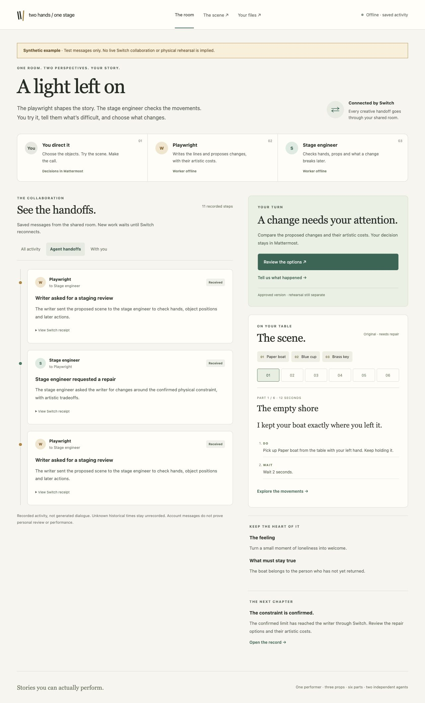

# Two Hands, One Stage

**Stories you can actually perform.**

[Live workbench](https://two-hands.52.202.25.181.sslip.io/studio) · [Public collaboration example](https://two-hands-one-stage.vercel.app/example) · [Source repository](https://github.com/himanshu748/two-hands-one-stage)

The **live workbench** runs on the existing Lightsail server with the SQLite API, two independent workers and real Switch/Mattermost. It requires the private performer login. The public `/example` remains an explicitly synthetic, read-only walkthrough; it does not call the live API. See [hosted setup and evidence](docs/lightsail.md). Credentials stay outside the repository and browser bundle.



**Hosted CI limitation (November 6):** GitHub refused to start the verification job because the account is locked due to a billing issue. Local checks passed; see [test evidence](docs/test-evidence.md).

A tabletop performer, a playwright agent and a stage engineer collaborate in one Switch room bridged to Mattermost. The performer chooses three props, an emotional goal and a protected story fact. The agents draft six beats. A genuine rehearsal difficulty becomes a human-confirmed constraint, localized alternatives with artistic costs, and an exact revision approved in Mattermost.

The workbench shows modeled hands, prop locations, blocking issues and before/after changes. Approval creates an offline timed cue player and printable HTML script from the same immutable revision. Human rehearsal evidence is recorded separately.

**Status:** the real writer → stage engineer handoff has run through the private Switch/Mattermost room using Modal. One six-beat candidate passed whole-scene validation; the user delegated exact approval to the operator, and both matching artifacts were delivered and opened from Mattermost. Personal review, a genuine physical observation, repair and successful rehearsal remain pending. The November 6 run also verified restart fixes; see [live demonstration evidence](docs/live-demo-20261106.md) for the exact results. The earlier Docker Cloud session remains stopped. The new Lightsail deployment runs independently of this Mac, with a separate room/account mapping and preserved local historical evidence. New hosted approval and physical rehearsal are recorded separately. Local browser tests use labeled synthetic scenes. This is a bounded hackathon MVP, not a production-readiness claim. See [test evidence](docs/test-evidence.md) and [Switch compatibility](docs/switch-compatibility.md).

## Scope

One human; three stable prop IDs; six stable beat IDs; one room/channel; two independent workers; up to three alternatives; two HTML outputs. Actions are `hold`, `place`, `move`, `release`, `speak`, `pause`. The supported confirmed constraint keeps one hand free throughout. Table, resting surface and cue device are environmental resources. Balance, weight, reach, comfort and timing require rehearsal. No generated voice/music, robotics, motion capture, generic choreography system or alternate browser approval path.

## Prerequisites and installation

Verified toolchain: **Node.js 22.14.0**, **pnpm 10.34.9**. `.node-version` and `packageManager` pin these; engines allow Node 22.14–22.x. Exact dependencies include TypeScript 5.9.3, React 19.2.3, Vite 8.3.5, Fastify 5.12.8, Zod 3.25.76, better-sqlite3 13.0.3, ws 8.18.3, OpenAI SDK 7.50.0, Vitest 5.1.0 and Playwright 1.64.1.

Install pinned Node from the [official distribution](https://nodejs.org/en/download). No global TypeScript, Vite, tsx, Playwright or pnpm is required:

```sh
npx --yes pnpm@10.34.9 install --frozen-lockfile
npx --yes pnpm@10.34.9 exec playwright install chromium
npx --yes pnpm@10.34.9 lint
npx --yes pnpm@10.34.9 typecheck
npx --yes pnpm@10.34.9 test
npx --yes pnpm@10.34.9 test:process
npx --yes pnpm@10.34.9 build
npx --yes pnpm@10.34.9 test:e2e
```

The remaining examples use `pnpm`; substitute `npx --yes pnpm@10.34.9` if needed. Tests need no private credentials. Browser tests start an explicitly synthetic API and Vite. Linux CI installs browser OS dependencies with `playwright install --with-deps chromium`. If better-sqlite3 lacks a prebuilt binary for your platform, its native build toolchain is required.

Package exports point to typed ESM source consumed by the declared tsx runtime and Vite. Build typechecks everything, emits package/service JavaScript and declarations, and bundles the web app. Run server source through the documented tsx entrypoints; each `dist` directory is not a self-contained server distribution.

## Explore the interface first

```sh
pnpm --filter @two-hands/web dev --port 5186
```

Open [the landing page](http://127.0.0.1:5186). Its animated tabletop and two repair alternatives are explicitly synthetic and work without accounts or model calls. Move through six beats, keep the left hand free, and compare the artistic tradeoffs. Sample cue/script links open real static HTML files.

The player now starts with named props and plain setup instructions. Use **Read the whole scene** before **Start the scene**; dialogue appears where you say it in the numbered action list. Technical details remain available on demand. See [the clarity follow-up](docs/clarity-followup.md).

[The studio](http://127.0.0.1:5186/studio) reads the application API. Without the API it shows a connection error; it never substitutes the landing example. With a scene, use the storyboard rail, action stepping, prop inspection, original/candidate comparison, and cue transport. Repairs, takeaways and the inspectable record have separate tabs. Human approval stays in Mattermost. Reduced-motion preferences disable the position/reveal animations.

Public official interfaces from Boords, Arc Studio and CuePilot informed this redesign; [the research record](docs/design-research.md) separates documented screenshots from live controls inspected. No authenticated third-party workspaces or assets were copied.

## Local Switch with Docker

The official tagged Compose stack and private configuration helper are included. Run `pnpm switch:local prepare`, then `pnpm switch:local check`. Follow [local-switch.md](docs/local-switch.md) for the dedicated Docker context, pull/start/stop commands and account linking. The attempted installation started Docker Engine 29.5.2 but image extraction exhausted host storage; the new empty failed profile was removed. That local attempt started no Switch/Mattermost service. The subsequent [private cloud run](docs/cloud-run.md) succeeded. The helper now requires a conservative 12 GiB free-host-space reserve before pulls. Existing credentials in `work/local-switch/.env` are preserved.

## Configure real collaboration

For this prepared workspace, preserve the existing private `.env`, registered agent keys and reviewed account mapping. No OpenAI API key is needed: `MODEL_PROVIDER=modal` selects the authenticated Modal Shared Endpoint. The small provider probe and a later, separately authorized real writer/stage run passed. Cloud runtime and model usage require a bounded allowance; do not assume a previously approved window authorizes another run. See [Modal setup](docs/modal-setup.md) and [the November 6 live run](docs/live-demo-20261106.md). The sequence below also documents a fresh installation.

1. Only if `.env` does not already exist, copy `.env.example` to `.env`; then run `chmod 600 .env`. Preserve existing credentials. For a fresh configuration, generate distinct internal worker tokens using its example command. Set `DATABASE_PATH=work/demo.sqlite`; `DISPOSABLE_DEMO_DATABASE_PATH` explicitly opts into reset. Credentials, `work/` and databases are ignored.
2. Follow [official Switch setup](https://docs.switchagents.ai/switch-rooms/getting-started). Start Docker for a local deployment, or use a supplied bridge. `SWITCH_BASE_URL` is the **agent bridge**, not Gateway. Remote bridges require HTTPS. No Core/Console version pair is presumed compatible.
3. Create one Mattermost channel and intended Switch room. Link the performer's Mattermost account to the correct Switch user. Set `SWITCH_ROOM_ID`. A shared bot identity or display name cannot authorize approval.
4. Set the one-time `SWITCH_REGISTRATION_TOKEN` and run `pnpm register:agents`. This registers `two-hands-writer` and `two-hands-stage` through `/agents`; returned credentials go only to mode-0600 `work/switch-registration.env`. Copy those fields to `.env`, then remove the registration token from the runtime environment. Do not register on each launch. Inspect partial failures instead of overwriting existing agents.
5. Invite both agents to the room. In the owner UI explicitly allow owner and owner agents, or the specific human/peer/room policy. Documentation conflicts about defaults and self-editing; this app does not silently widen policy. Set `WRITER_SWITCH_SENDER` and `STAGE_SWITCH_SENDER` to exact opaque participant IDs, not registration UUIDs.
6. Complete the [identity audit](docs/switch-compatibility.md). `HUMAN_IDENTITY_FILE` must name reviewed local JSON with `roomId`, `bridgeId`, `participantId`, `mattermostUserId`, `mattermostChannelId`, ISO `verifiedAt`, and an `evidence` explanation of at least 20 characters. Verify account claim/backend mapping and a unique nonce event. Never guess from a name or ID prefix.
7. Select `MODEL_PROVIDER=modal` and configure the three Modal variables in [Modal setup](docs/modal-setup.md), or select `openai` and set `OPENAI_API_KEY` and `OPENAI_MODEL` explicitly. The official SDK adapters have no tools, a 45-second OpenAI / 75-second Modal timeout, 6,000 output-token cap, 100,000-character input/instruction cap and at most two durable calls per job. There is no provider or mock fallback. Calls may incur account charges. A small Modal probe and the later authorized writer/stage calls have run; provider billing settings were not changed.
8. Run `pnpm verify:switch`. Default checks health and discovered schemas without claiming the room. With workers stopped, `pnpm verify:switch --connect` also tests WebSocket connections and room operations. Transport checks do **not** establish human identity, approval or physical rehearsal.

Official sources inspected November 4, 2026 and runtime limitations are recorded in [switch-compatibility.md](docs/switch-compatibility.md). Sanitized actual live agent envelopes are included there. The November 6 creative run and delegated approval are documented separately; personal review and physical rehearsal remain pending.

## Check readiness without starting services

```sh
pnpm readiness
pnpm readiness --offline
```

This read-only preflight reports all missing configuration names, distinct-worker
settings, saved mapping consistency and local launch settings together. By default
it also makes one unauthenticated, five-second health request to the configured
Switch bridge. `--offline` sends no network request. Neither mode starts or resumes
a sandbox, opens SQLite, claims a Switch room, calls a model or writes an approval.
Values and private mapping contents are never printed. Exit `1` means a prerequisite
is blocked; exit `0` means only the named preflight checks passed. Saved identity
evidence is historical until re-audited after any account or runtime changes.

The November 6 offline preflight passed with Modal configured; live bridge discovery and both worker connections also passed during the later bounded run. Stopped infrastructure must be resumed under an applicable allowance before further collaboration. Offline preflight alone does not verify it.
See [the readiness follow-up](docs/readiness-followup.md) for actual results and
remaining human acceptance steps.

## Run and perform

```sh
pnpm dev
```

This preflights configuration, starts the API on `127.0.0.1:4310`, Vite on the loopback port in `PUBLIC_APP_URL` (default `127.0.0.1:5173`), and both workers with prefixed logs. If one exits, it stops the others. Ctrl+C shuts down all four; durable state remains. Missing configuration fails explicitly, with no synthetic fallback.

Open `/studio` at your configured `PUBLIC_APP_URL`. If 5173 is occupied, use `PUBLIC_APP_URL=http://127.0.0.1:5186`; the existing application is left untouched. Send the brief and commands **in the linked Mattermost channel**, addressed to the documented worker. The complete performance and exact grammar are in [demo-script.md](docs/demo-script.md). The empty studio includes a local brief composer: enter the title, three props, emotional goal and protected fact, then copy its command into Mattermost. It sends no application mutation and stores no browser draft. If initial drafting is rejected or blocked, the verified performer can request `@two-hands-writer retry-draft` at most three times; the brief stays unchanged.

The first live milestone is a human brief → writer → stage engineer → exact human approval through that room.

To inspect the empty API without Switch, omit `HUMAN_IDENTITY_FILE` and provide only `DATABASE_PATH` and distinct internal tokens, then run `pnpm --filter @two-hands/api dev` and `pnpm --filter @two-hands/web dev` in separate terminals. Human commands and collaborative work remain disabled; this is a setup view, not substitute integration.

## Artifacts and evidence

After approval, the workbench and Switch notification link to:

- `/artifacts/<revisionId>/cue.html` — standalone timed player with five-second lead-in, large controls and Escape pause.
- `/artifacts/<revisionId>/script.html` — print-ready six-beat script.

Both derive from the same immutable SQLite revision and contain its SHA-256 digest. Save the HTML locally before disconnecting; an HTTP link is not an offline export. The player makes no network requests. Controls assume a free hand; rest props before pausing and reset initial positions before restarting. Playback never writes rehearsal evidence.

`PUBLIC_APP_URL` defaults to the workbench origin, whose Vite proxy serves artifacts. Open both links from the **actual demonstration device** before claiming delivery. Loopback links work on that same machine; another device cannot use them. Public deployment/tunneling is not included or authorized.

The inspectable application record includes original observations, separate interpretations, confirmations, proposals, exact diffs, validation, approval/revocation records, rehearsal outcomes, jobs and notification delivery state. Keep personal database content local. See [state-and-approval.md](docs/state-and-approval.md).

## Commands

| Command | Purpose |
| --- | --- |
| `pnpm dev` | Start API, workbench and both real workers after preflight |
| `pnpm build` | Typecheck, compile packages/services, bundle workbench |
| `pnpm lint` | Shared ESLint checks |
| `pnpm typecheck` | Strict TypeScript across source and tests |
| `pnpm test` | Domain, transport-fixture, model-fixture and SQLite service tests |
| `pnpm test:process` | Synthetic startup/shutdown and reversible reset safeguards |
| `pnpm test:e2e` | Chromium workbench/offline artifact tests, explicitly synthetic |
| `pnpm verify:human <reviewed-candidate.json> [seconds]` | Fresh performer nonce audit; no model call or scene approval |
| `pnpm verify:switch` | Real runtime health/schema report with separate manual gates |
| `pnpm verify:model [--call]` | Default: local configuration only. `--call`: one potentially billable schema probe; authorize usage first |
| `pnpm readiness [--offline]` | Read-only combined prerequisite report; never starts services or spends |
| `pnpm switch:local check/prepare/pull/up/status/stop` | Explicit local Docker setup; no provider calls or public deployment |
| `pnpm register:agents` | One-time registration of two distinct agents |
| `pnpm demo:reset` | Reversibly archive only the configured disposable database |

## Recovery and reset

Restart with the same database and agent credentials. Connection IDs, cursors and generations persist through the API. Jobs resume after their 180-second leases expire, with three recovery claims and two model calls maximum across restarts. Results and outbox records persist transactionally. Duplicates have one application effect. Gaps, takeover, exhausted budgets and uncertain notifications remain visible.

An outbound request can reach Switch even if its response is lost. That delivery is held as `uncertain`; reconcile room history before retrying. Exactly-once external messaging is not promised without verified provider idempotency. See [recovery policy](docs/state-and-approval.md).

Do not edit/delete operational messages to retract them. Send `revoke <messageId>`; reliable platform edit/delete events are not established by the public protocol. Revocation holds new approval and marks history; downloaded files cannot be recalled. Export evidence and start a fresh disposable scene after a revocation hold.

Stop all processes before `pnpm demo:reset`. It requires matching configured paths inside this workspace's `work/` directory, named `demo.sqlite`, and refuses active ports/locks, symlinks, hard links and other paths. It moves the database and sidecars to `work/demo-backups/`; it does not clear Switch messages, credentials or exported HTML. Inspect recorded PIDs before removing stale locks. To restore a backup, stop processes and restore its database and matching sidecars together.

## Repository

```text
apps/
  web/             Landing page + interactive rehearsal studio (read only)
  api/             Fastify, SQLite migrations, fixed HTML templates
  writer-agent/    Independent playwright process
  stage-agent/     Independent stage-engineer process
packages/
  domain/          Browser-safe schemas, actions, validation, patch rules
  switch-client/   Operations, events and connection contract
  agent-runtime/   Explicit OpenAI/Modal structured output, bounded jobs, worker utilities
fixtures/          Explicitly synthetic scene/service helpers
tests/
  integration/     SQLite lifecycle and rendering tests
  e2e/             Landing, studio and offline artifact browser tests
scripts/           Startup, verification, registration, reset, test harness
docs/              Product, architecture, compatibility, approval, evidence
.github/workflows/ci.yml
```

See [PRD.md](docs/PRD.md), [architecture.md](docs/architecture.md) and [action-model.md](docs/action-model.md).

## Remaining manual acceptance

The current cloud runtime, exact versions, operation schemas and addressed peer messages have been verified. The account nonce audit is also complete, with automated provenance recorded. The real writer/stage run, user-delegated exact approval and opening both artifact links have passed. Next, rehearse with the actual props; report a genuine difficulty if one occurs; confirm an accurate supported constraint; choose a repair for its artistic cost; perform it and report the outcome. Do not manufacture an impossible scene or call synthetic outcomes human evidence. Event registration, submission, publication, remote pushes and public deployment remain outside this work.

For an uncertain notification, inspect actual room history, then record the operator decision (never put credentials in the evidence):

```sh
pnpm recover:delivery stage '<deliveryId>' delivered 'Verified the corresponding Switch message ID in room history'
# Use retry instead of delivered only after verifying the message was not delivered.
```

Reconciliation is role-scoped, recorded in SQLite and limited to three send attempts. It cannot approve a scene or bypass human identity checks.

## Docker Cloud alternative

For this machine’s disk-constrained setup, [the Docker Cloud guide](docs/cloud-switch.md) records verified account access, the prepared Compose workaround, private connectivity requirements and bounded compute costs. The authorized cloud run successfully started Core 0.31.0 and Mattermost 11.9.0. Both agents passed live transport checks over private SSH forwards. The account nonce check subsequently passed through user-authorized automation. Modal also completed real writer/stage calls in the November 6 continuation. User-delegated exact approval and artifact delivery passed; personal review and physical rehearsal remain pending. Existing private `.env` and registered identities must be preserved; do not re-register them. The existing local Docker instructions remain available.
